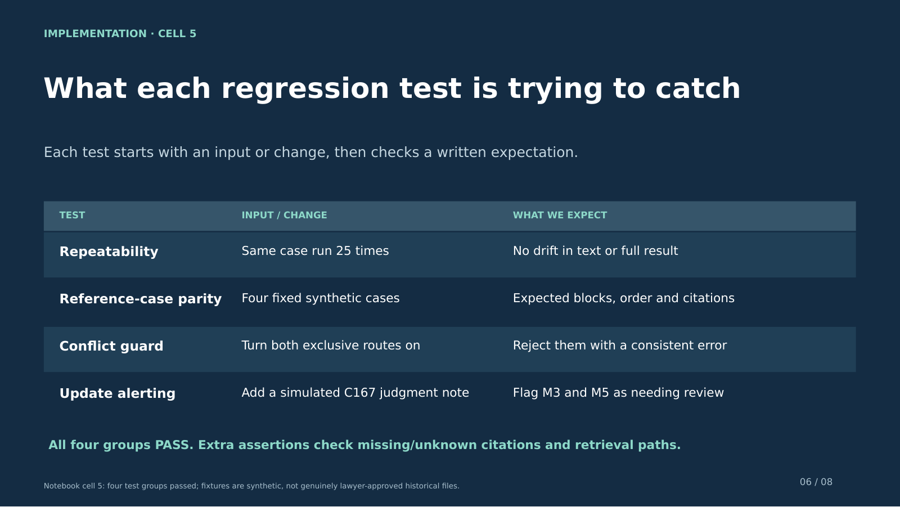
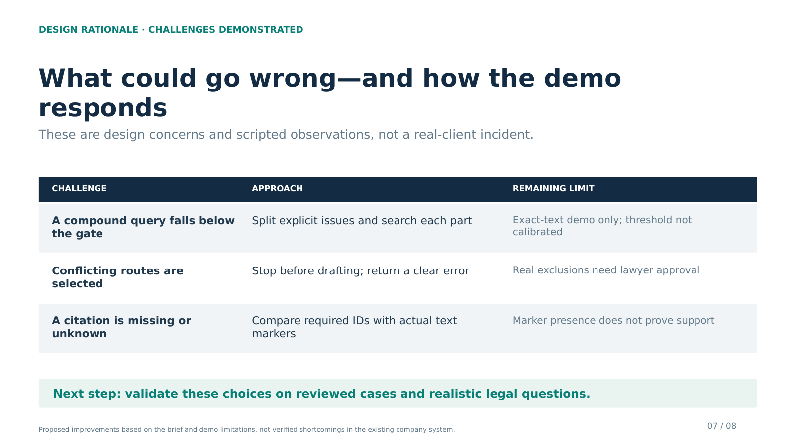
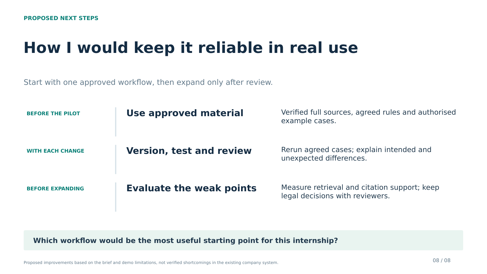

# Final interview presentation

Eight plain-language slides with varied layouts and concrete examples. Slides 3–6 show the source/rule fields, actual sample module decisions, retrieval/decomposition steps and each regression test's input and expected outcome. The challenges slide explains real design concerns without inventing a project incident. Suggested full walkthrough: 6–7 minutes; ask whether the interviewer wants this level of detail.

- [Download PowerPoint](Nafis_Ismam_Docitalis_Final.pptx?raw=true)
- [View PDF](Nafis_Ismam_Docitalis_Final.pdf)
- [Read the speaking guide](speaker_notes.md)

For Google Slides, download the PPTX, upload it to Drive and open with Google Slides. Check layout after importing.

## Flow

1. My understanding of the role.
2. Previous experience and its connection to the recent demonstration.
3. Cells 1 + 2: source fields, module conditions/dependencies, version and source links.
4. Cell 3: input facts, all seven inclusion/skip decisions and the resulting sequence.
5. Cell 4: direct search score → threshold failure → explicit decomposition → separate retrieval → merge; independent citation/update review.
6. Cell 5: four regression groups, their inputs and the failures they aim to catch.
7. Design challenges: the demo's response and the remaining limitation, not a fabricated development story.
8. Keeping it reliable: approved sources/cases, reviewed versions and realistic retrieval evaluation.

## Slide previews

### 1. Understanding the role

### 2. Previous experience

### 3. Sources and paragraph rules

### 4. Actual module selection

### 5. Retrieval and decomposition

### 6. Regression inputs and expectations

### 7. Challenges, approaches and limitations

### 8. Keeping it reliable

## Sources and scope

- The original internship posting supplied by the candidate describes work with lawyers, explicit rules, versioned assembly, historical-case regression testing, assistive RAG review and an appeals extension. The deck explains that brief, not Docitalis's existing internal software.
- [Docitalis](https://docitalis.com/) provides the public company context. The supplied posting states the connection with services for Aprigliano International Law Firm; the deck does not infer corporate ownership.
- Earlier research responsibilities are based on the candidate's account. They are separate from this recent demonstration and from implementation of the full published research pipeline.
- [The executed notebook](../Legal_Knowledge_and_RAG_Prototype.ipynb) provides the demonstration and test evidence. It uses sample summaries and fictional cases/judgments, not complete verified official text or genuinely lawyer-approved historical cases. Passing tests does not establish legal accuracy. Its review checks markers and recorded dates; it does not assess legal applicability or run a generative review model. Technical inspiration is credited in the notebook.

The previous two decks have been removed from the current repository version. They remain recoverable through normal Git history.
