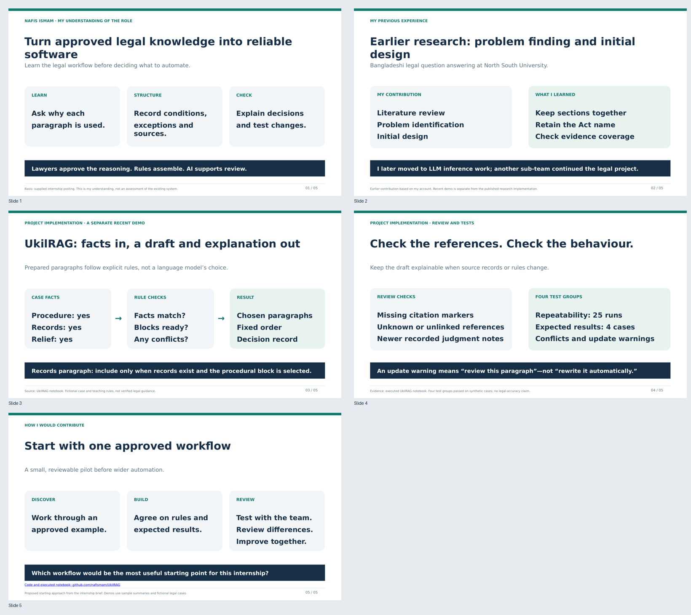
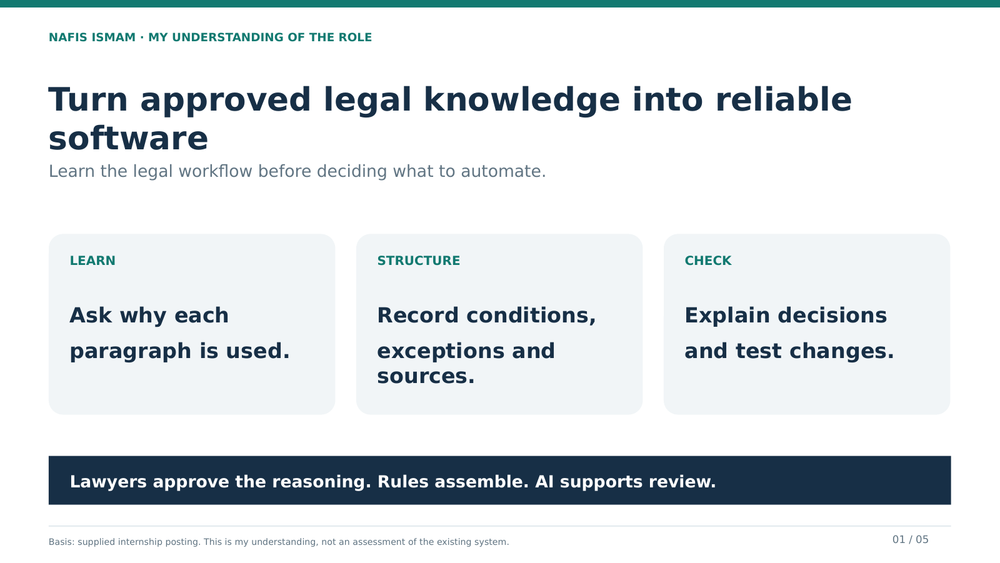
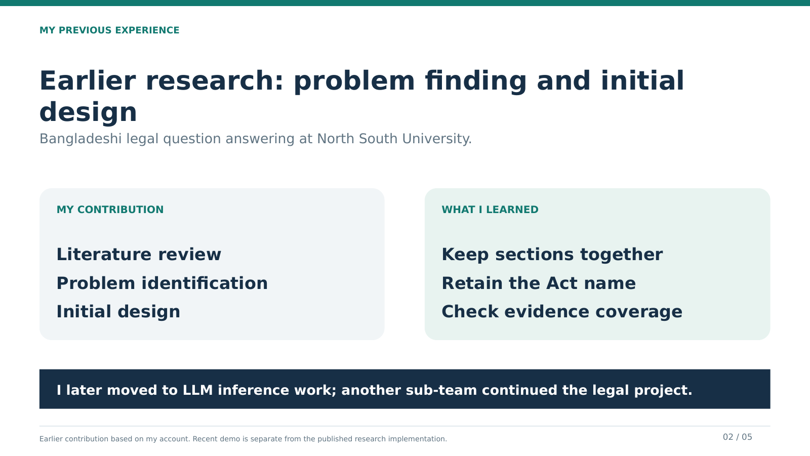
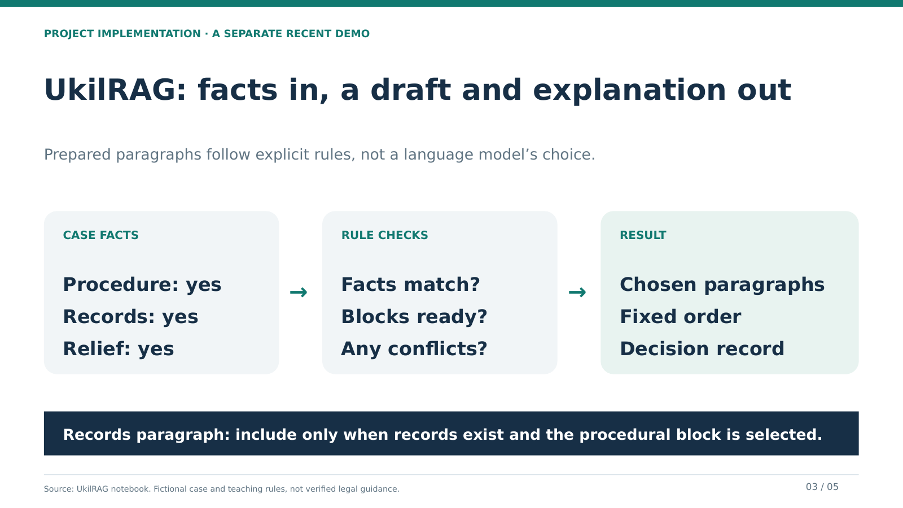
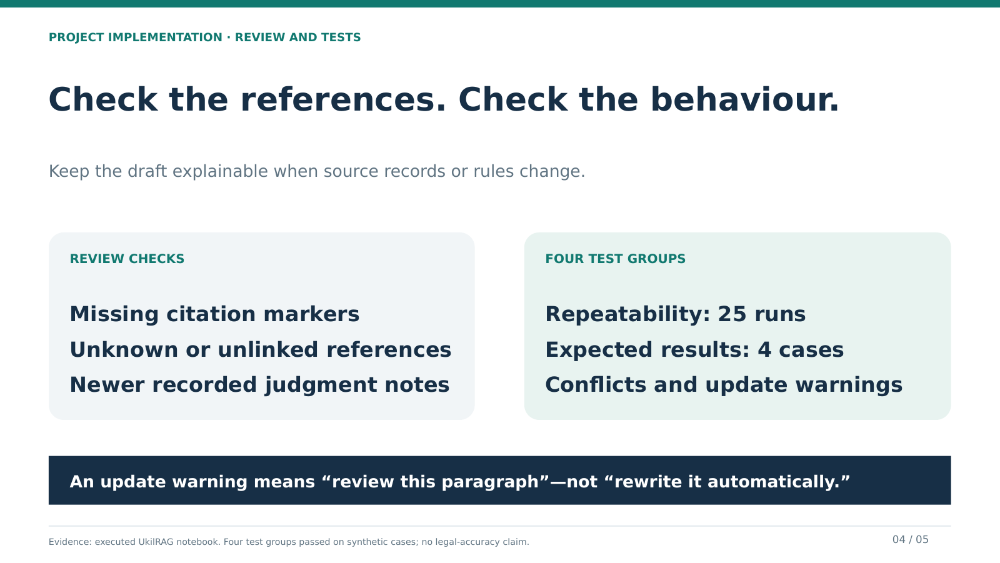
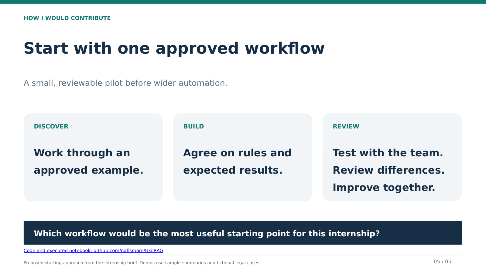

# Final interview presentation

One five-slide deck combining role understanding, previous experience and the recent UkilRAG implementation. Suggested length: 3–4 minutes.

- [Download PowerPoint](Nafis_Ismam_Docitalis_Final.pptx?raw=true)
- [View PDF](Nafis_Ismam_Docitalis_Final.pdf)
- [Read the speaking guide](speaker_notes.md)

For Google Slides, download the PPTX, upload it to Drive, and open with Google Slides. Check the layout after importing.

## Flow

1. **My understanding:** learn lawyers' reasoning, record approved rules, explain outputs and test changes.
2. **My previous experience:** literature review, problem identification and initial design for Bangladeshi legal question answering.
3. **Project implementation:** a fictional case passes through rule checks to a prepared draft and decision record.
4. **Review and tests:** citation-marker checks, recorded source-update warnings and four regression groups on synthetic examples.
5. **How I would contribute:** start with one approved workflow, agree on examples and review a small pilot with the team.

## Slide previews

### 1. My understanding of the role

### 2. My previous experience

### 3. Project implementation

### 4. Review and testing

### 5. How I would contribute

## Sources and scope

- The original internship posting supplied by the candidate describes work with lawyers, explicit rules, versioned assembly, historical-case regression testing, assistive RAG review and an appeals extension. The deck explains that brief, not Docitalis's existing internal software.
- [Docitalis](https://docitalis.com/) provides the public company context. The supplied posting states the connection with services for Aprigliano International Law Firm; the deck does not infer corporate ownership.
- Earlier research responsibilities are based on the candidate's account. They are separate from this recent demonstration and from implementation of the full published research pipeline.
- [The executed notebook](../Legal_Knowledge_and_RAG_Prototype.ipynb) provides the demonstration and test evidence. It uses sample summaries and fictional cases/judgments, not complete verified official text or genuinely lawyer-approved historical cases. Passing tests does not establish legal accuracy. Its review checks markers and recorded dates; it does not assess legal applicability or run a generative review model. Technical inspiration is credited in the notebook.

The previous two decks have been removed from the current repository version. They remain recoverable through normal Git history.
