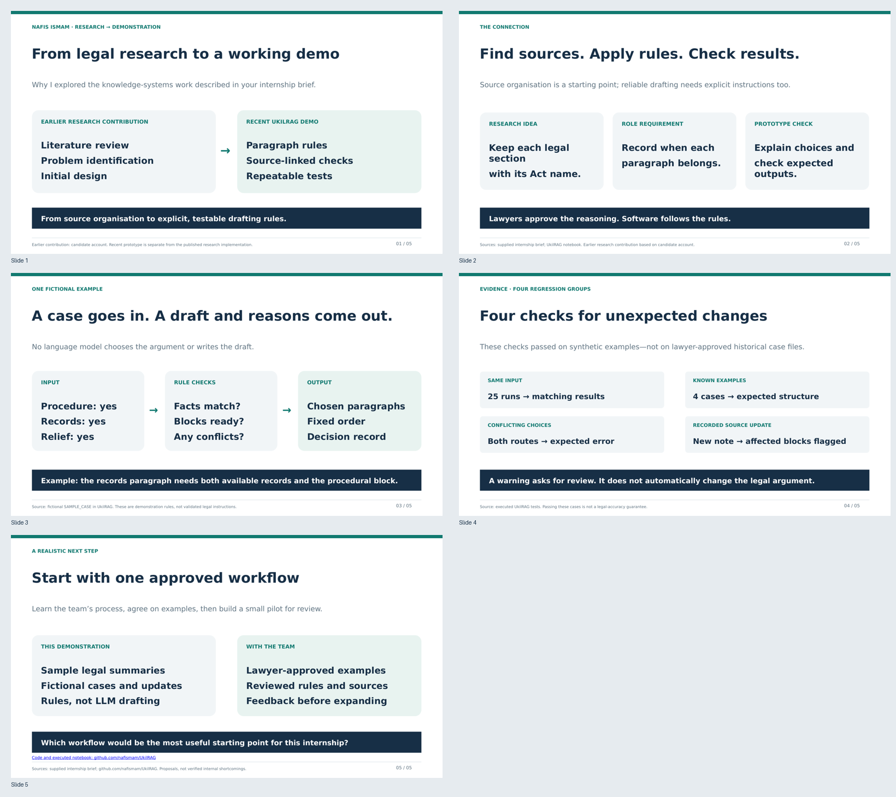
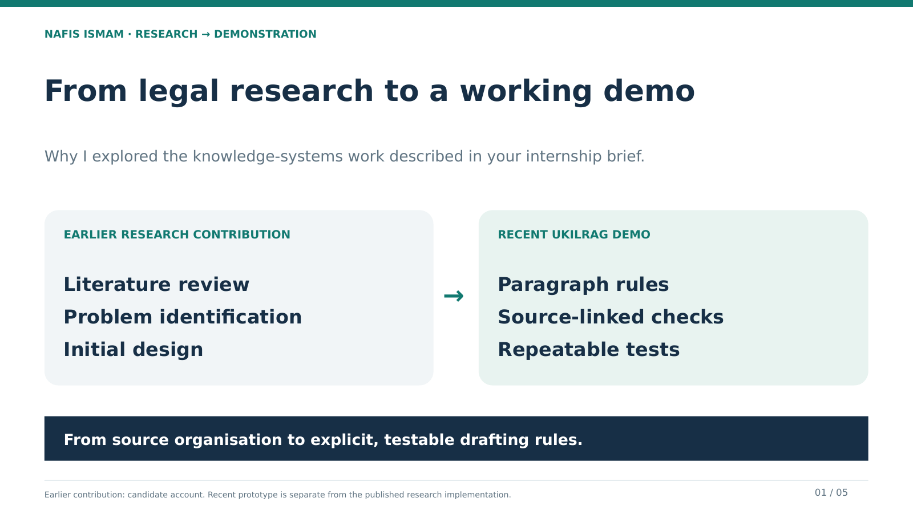
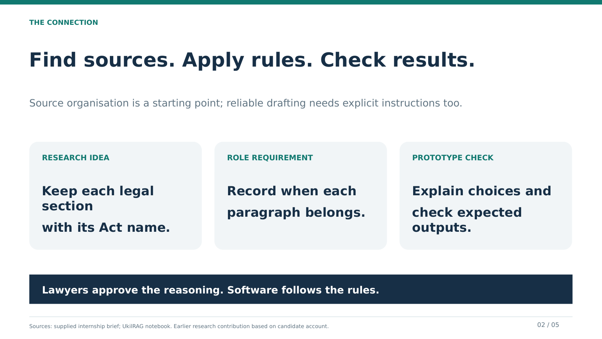
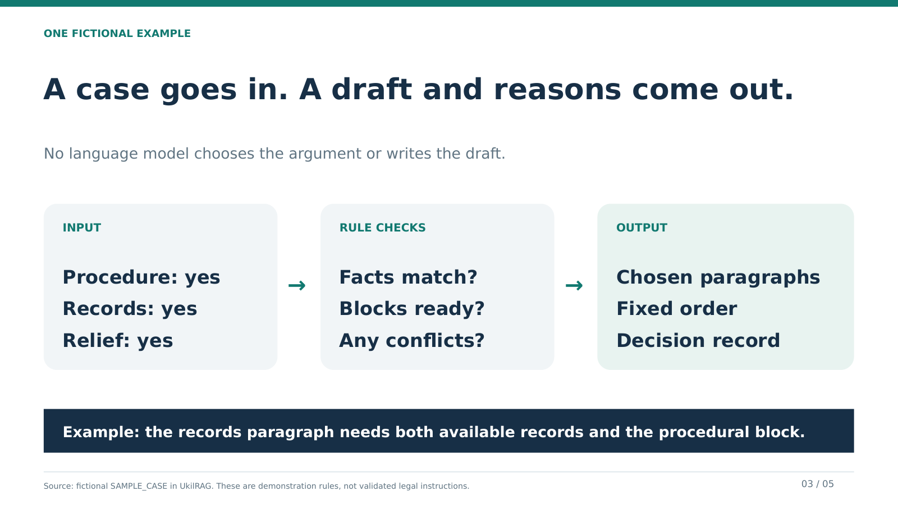
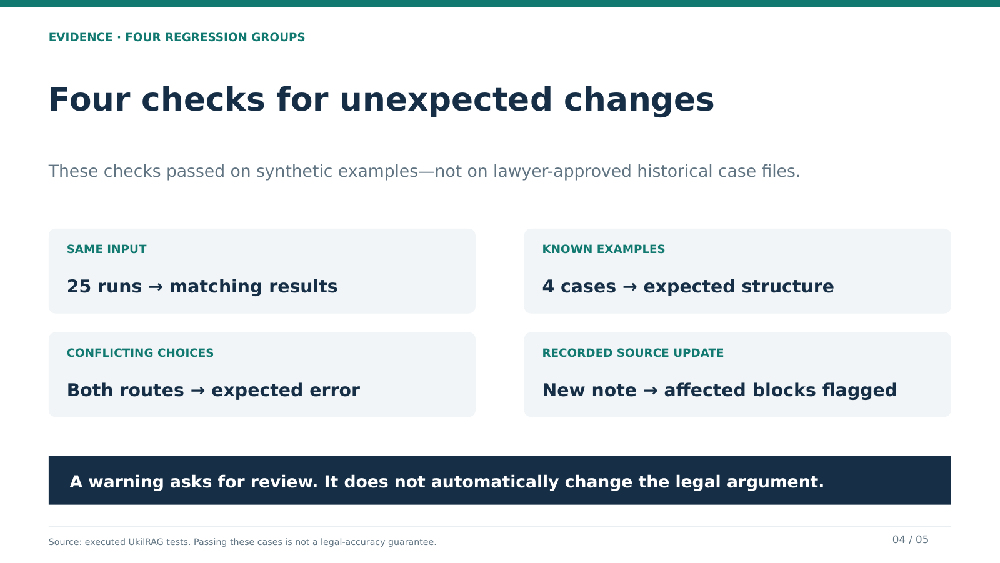
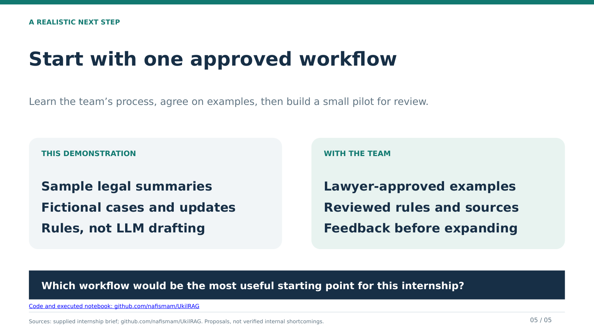

# From legal research to a working demo

Five compact slides for an optional 3–4 minute interview walkthrough. This deck connects the candidate's earlier literature review and design contribution to the recent UkilRAG demonstration and the requirements in the internship brief.

- [Download the PowerPoint](Research_to_Role.pptx?raw=true)
- [View the PDF](Research_to_Role.pdf)
- [Slide-by-slide speaking guide](speaker_notes.md)

For Google Slides: download the PPTX, upload it to Drive, and choose **Open with → Google Slides**. Check the layout after importing.

## What to explain

1. **Research → demo:** earlier literature review, problem identification and initial design are separate from this recent implementation.
2. **The connection:** source labels help identify evidence; drafting also needs explicit conditions and checks.
3. **One case:** case facts select prepared paragraphs; the decision record explains which were included or skipped.
4. **Four checks:** repeatability, expected structure/citations, conflict rejection and recorded update alerts. The fixtures are synthetic.
5. **First contribution:** learn one approved workflow, agree on examples and build a small pilot with feedback.

## Preview

### Slide 1

### Slide 2

### Slide 3

### Slide 4

### Slide 5

## Basis of the deck

- Earlier research responsibilities are based on the candidate's account. This notebook is not the original published research implementation.
- Role requirements come from the original internship posting supplied by the candidate, including explicit rules, versioned modules, regression tests and assistive source-backed review. This is not an assessment of Docitalis's internal software.
- The demonstration and reported checks come from [the executed UkilRAG notebook](../../Legal_Knowledge_and_RAG_Prototype.ipynb).
- Technical inspiration remains credited in the notebook. Sources include educational summaries, not verified full official sections. Judgments and test cases are fictional. The review checks citation markers and recorded dates, not legal applicability. The notebook has no generative review model, production database or implemented appeals workflow.

The intended message is understanding of the role and a proposed starting approach, not production readiness or legal accuracy. Speaker notes give the extra detail so the slides can stay brief.
